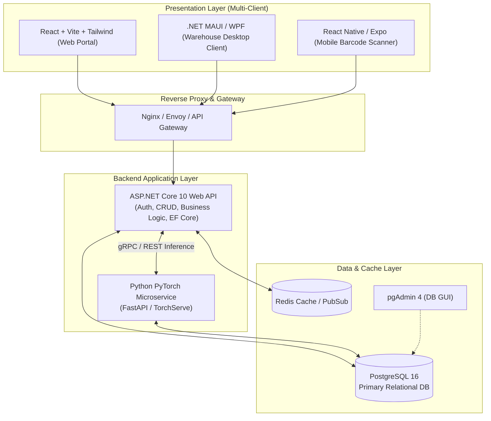
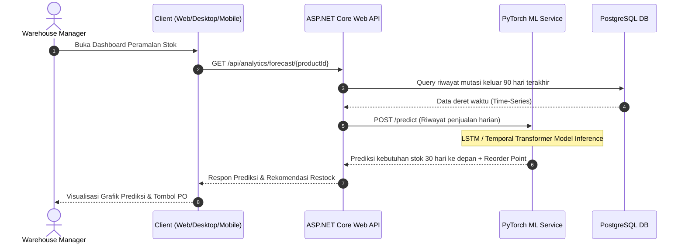
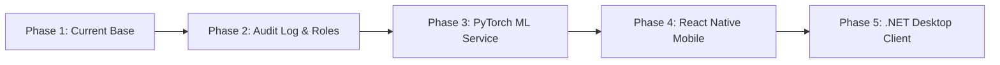

# Stockify - Comprehensive Implementation & Future Roadmap Document

Dokumen ini memuat blueprint arsitektur, spesifikasi fitur lengkap, dan panduan teknis pengembangan lanjutan ekosistem **Stockify (Enterprise Warehouse & Inventory Management System)**.

---

## 1. Arsitektur Ekosistem Target

Sistem dirancang dengan arsitektur micro-service/modular monolith yang dapat diskalakan (*scalable*), mendukung multi-platform client (Web, Desktop, Mobile), serta terintegrasi dengan kecerdasan buatan (Machine Learning) untuk peramalan kebutuhan stok (*Demand Forecasting*).



---

## 2. Status Implementasi Saat Ini (Current State)

| Komponen | Status | Teknologi | Fitur Aktif |
| :--- | :--- | :--- | :--- |
| **Backend API** | ✅ Production-ready | ASP.NET Core (.NET 10) | JWT Authentication, BCrypt Hashing, Product & Category CRUD, EF Core Npgsql, Role Based (Admin/Staff). |
| **Web Client** | ✅ Production-ready | React 19 + Vite + Tailwind v4 | Auth UI, JWT Interceptor, Dynamic Metric Cards, Product Table, Low Stock Alert, Modal CRUD. |
| **Database** | ✅ Production-ready | PostgreSQL 16 Alpine | Persistent volume, indexed SKU, auto-migration. |
| **DB Admin** | ✅ Production-ready | pgAdmin 4 | Web GUI DB visual management di port 5050. |
| **Deployment** | ✅ Production-ready | Docker Compose | Multi-container automated orchestration. |

---

## 3. Pengembangan Fitur Bisnis Lengkap (Core Expansion)

Untuk meningkatkan kapabilitas ke tingkat *enterprise*, fitur berikut dirancang untuk melengkapi sistem:

### 3.1. Inventory & Stock Mutation Tracking
- **Stock Movement Log (Audit Trail)**: Setiap perubahan stok (In/Out/Adjustment) wajib mencatat `QuantityChanged`, `Type` (Incoming, Outgoing, Damaged, Correction), `Timestamp`, `UserId`, dan `Notes`.
- **Batch & Expiration Tracking**: Dukungan Nomor Batch produksi dan tanggal kadaluarsa (*FIFO/FEFO logic*) untuk industri makanan/farmasi.
- **Multi-Warehouse / Multi-Rak Location**: Penempatan barang berbasis Gudang $\rightarrow$ Zona $\rightarrow$ Baris $\rightarrow$ Rak (*Bin Location*).

### 3.2. Granular Role & Permission Management (RBAC)
- Penambahan Roles: `SuperAdmin`, `WarehouseManager`, `WarehouseStaff`, `Purchasing`, dan `Auditor`.
- Permission policy berbasis Claims (misal: `inventory.create`, `inventory.adjust`, `reports.export`).

### 3.3. Reporting & Analytics
- Export laporan stok, ringkasan mutasi, dan rekap nilai aset gudang ke format **PDF** dan **Excel/CSV**.
- Webhook & Notifikasi email otomatis jika stok berada di bawah batas minimum (*Safety Stock*).

---

## 4. Penerapan Machine Learning (PyTorch Service)

Modul AI diintegrasikan sebagai *microservice* mandiri berbasis **Python (FastAPI + PyTorch)** yang melayani estimasi kebutuhan stok gudang dan deteksi anomali mutasi barang.



### 4.1. Use Cases Machine Learning
1. **Demand Forecasting (Peramalan Permintaan Stok)**:
   - **Arsitektur Model**: LSTM (Long Short-Term Memory) atau Temporal Fusion Transformer (TFT).
   - **Input Features**: Tanggal transaksi, kuantitas mutasi harian, hari dalam seminggu, tren bulanan, event promo/musiman.
   - **Output**: Estimasi kebutuhan stok $N$-hari ke depan dan kalkulasi otomatis tanggal aman *Reorder Point (ROP)*.
2. **Anomaly Detection (Deteksi Penyusutan/Fraud Gudang)**:
   - **Arsitektur Model**: Autoencoder / Isolation Forest berbasis PyTorch.
   - **Fungsi**: Mendeteksi pola pengurangan stok yang tidak wajar (potensi kerusakan, kesalahan input barcode, atau kehilangan).

### 4.2. Rencana Struktur Folder ML Service
```text
D:\Project\Stockify\ml-service/
├── app/
│   ├── main.py               # FastAPI entrypoint
│   ├── models/
│   │   └── lstm_forecaster.py# Definisi model PyTorch (nn.Module)
│   ├── weights/
│   │   └── stock_lstm.pth    # Checkpoint bobot model terlatih
│   └── services/
│       ├── data_pipeline.py  # Preprocessing & MinMax Scaling
│       └── predictor.py      # Inference engine
├── requirements.txt          # torch, torchvision, fastapi, uvicorn, numpy, pandas
└── Dockerfile
```

---

## 5. Frontend Versi Desktop (.NET MAUI / WPF)

Client Desktop dirancang khusus untuk komputer operasional di loket gudang (*Warehouse Counter*) yang terhubung langsung dengan perangkat keras: scanner barcode USB/Serial, thermal label printer, dan timbangan digital.

### 5.1. Teknologi: .NET MAUI / Modern WPF
- **Framework**: C# .NET 10 (cross-platform Windows & macOS via .NET MAUI, atau WPF dengan Fluent Design).
- **Komunikasi**: Mengonsumsi REST API via `HttpClient` terenkripsi dengan JWT token yang disimpan pada Windows DPAPI (`SecureStorage`).
- **Offline Support**: SQLite lokal dengan mekanisme sinkronisasi dua arah saat koneksi jaringan gudang terputus.

### 5.2. Fitur Khusus Desktop Client:
- **Fast POS-like Mode**: Mode kasir/gudang cepat hanya menggunakan tombol shortcut keyboard (F1 - F12) tanpa mouse.
- **Hardware Integration**:
  - Auto-print label barcode SKU langsung ke printer Zebra/TSC via format ZPL/ESC-POS.
  - Listen input port COM/USB dari timbangan beban paket.

---

## 6. Frontend Versi Mobile (React Native)

Client Mobile diperuntukkan bagi petugas gudang (*picker/packer*) yang bergerak aktif di area rak gudang (*Warehouse Floor*).

### 6.1. Teknologi: React Native (Expo)
- **Framework**: React Native dengan TypeScript & Expo Router.
- **Styling**: NativeWind (Tailwind CSS untuk React Native) untuk menjaga keselarasan desain dengan versi Web.
- **State Management**: Zustand atau Redux Toolkit dengan persistensi `AsyncStorage`/`Keychain`.

### 6.2. Fitur Khusus Mobile Client:
- **Camera Barcode / QR Scanner**: Menggunakan library `expo-camera` / `react-native-vision-camera` untuk pemindaian instan kode SKU/QR rak secara real-time.
- **Stock Opname On-The-Go**: Menghitung fisik barang di lorong rak, scan barang $\rightarrow$ langsung membandingkan dengan data sistem.
- **Haptic Feedback & Audio Cues**: Suara bip sukses dan getaran haptic saat barcode berhasil terbaca dengan benar untuk mempercepat flow kerja operator.

---

## 7. Rencana Orkestrasi Docker Compose Lengkap

Saat semua komponen siap, konfigurasi multi-container di `docker-compose.yml` diperluas:

```yaml
services:
  # Database
  postgres-db:
    image: postgres:16-alpine
    container_name: stockify_postgres
    # ...

  # Cache & Event Bus
  redis:
    image: redis:7-alpine
    container_name: stockify_redis
    ports:
      - "6379:6379"

  # Core Backend API (.NET 10)
  api:
    build:
      context: .
      dockerfile: Dockerfile
    container_name: stockify_api
    depends_on:
      - postgres-db
      - redis
    # ...

  # AI / ML Microservice (PyTorch + FastAPI)
  ml-service:
    build:
      context: ./ml-service
      dockerfile: Dockerfile
    container_name: stockify_ml
    ports:
      - "8000:8000"
    depends_on:
      - postgres-db

  # Web Dashboard (React + Nginx)
  web:
    build:
      context: ./frontend
      dockerfile: Dockerfile
    container_name: stockify_web
    ports:
      - "3000:80"

  # Database Visual GUI
  pgadmin:
    image: dpage/pgadmin4:latest
    container_name: stockify_pgadmin
    ports:
      - "5050:80"
```

---

## 8. Milestone Tahapan Eksekusi



1. **Fase 1 (Selesai)**: Core Web API (.NET 10), EF Core, PostgreSQL, React Dashboard, Auth JWT, Docker Compose.
2. **Fase 2**: Penambahan tabel `StockMovements`, Batch tracking, dan role-based granular permissions.
3. **Fase 3**: Pembangunan PyTorch ML Service (Dataset generator $\rightarrow$ Training model LSTM $\rightarrow$ Deployment endpoint prediksi restock).
4. **Fase 4**: Pembuatan aplikasi React Native untuk Mobile Barcode Scanner.
5. **Fase 5**: Pembuatan aplikasi .NET Desktop Client (MAUI/WPF) untuk loket gudang dan cetak thermal.

